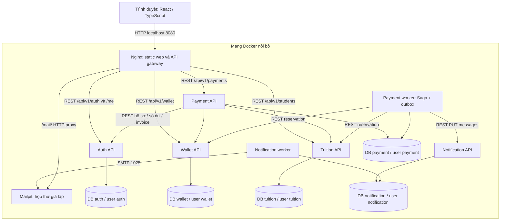

# Kiến trúc Microservices

[Bản SVG](rendered/architecture-1.svg).

Năm database nằm trong một PostgreSQL 18 instance cho demo, có năm role ứng dụng riêng. Mũi tên tới DB chỉ thuộc service sở hữu DB đó; không có query/join xuyên database. Payment API và Payment worker cùng sở hữu DB payment; tương tự Notification API/worker với DB notification. Đây là hai tiến trình của cùng service, không phải service nghiệp vụ thứ sáu/thứ bảy.

| Thành phần | Trách nhiệm và ranh giới |
|---|---|
| Auth | Kiểm tra mật khẩu Argon2, ký JWT RS256, cung cấp hồ sơ người nộp. |
| Wallet | Số dư/giữ tiền/ghi nợ; chỉ nhận lệnh tài chính từ Payment có service key. |
| Tuition | Sinh viên/khoản thu, giữ quyền thanh toán và đóng khoản thu. |
| Payment | OTP, snapshot, lịch sử, quyết định Saga và outbox email bền vững. |
| Notification | Lưu/dedup job email trước ACK, retry SMTP, xóa payload sau gửi/hết hạn. |
| Nginx | Chỉ route API công khai; không route `/internal`; phục vụ frontend và Mailpit. |

Public API yêu cầu JWT trừ login; lệnh REST nội bộ yêu cầu `X-Service-Key`. Tiền và người nộp được xác định ở backend. Không có broker; worker đọc công việc từ database bằng claim/lease và gọi HTTP ngoài transaction.

[Compose runtime](../../compose.yaml) chỉ bind cổng web vào loopback. Có thể dùng cùng cấu hình với tên project và cổng web khác để có database/volume demo riêng; xem [kịch bản demo](../demo/DEMO.md). Kết quả kiểm thử tự động trên stack riêng được chọn tại [biên bản kiểm chứng](../report/VERIFICATION.md). Email demo chỉ đi tới Mailpit theo yêu cầu hiện hành.
