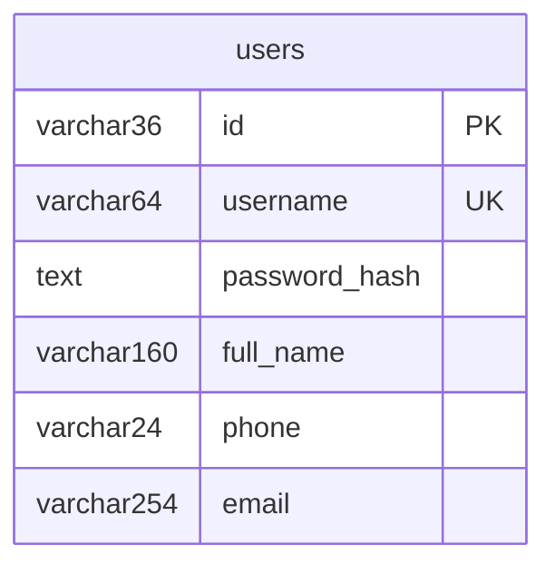
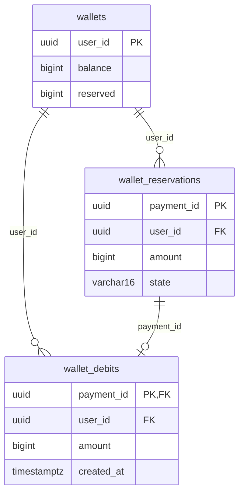
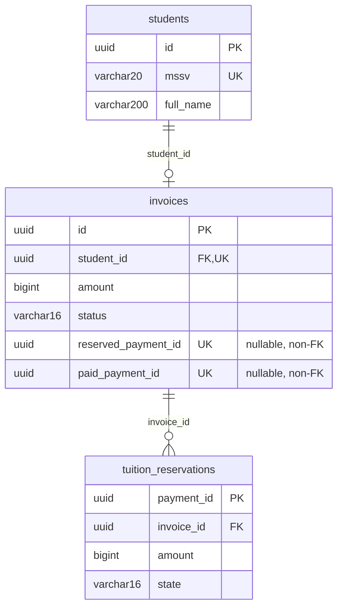
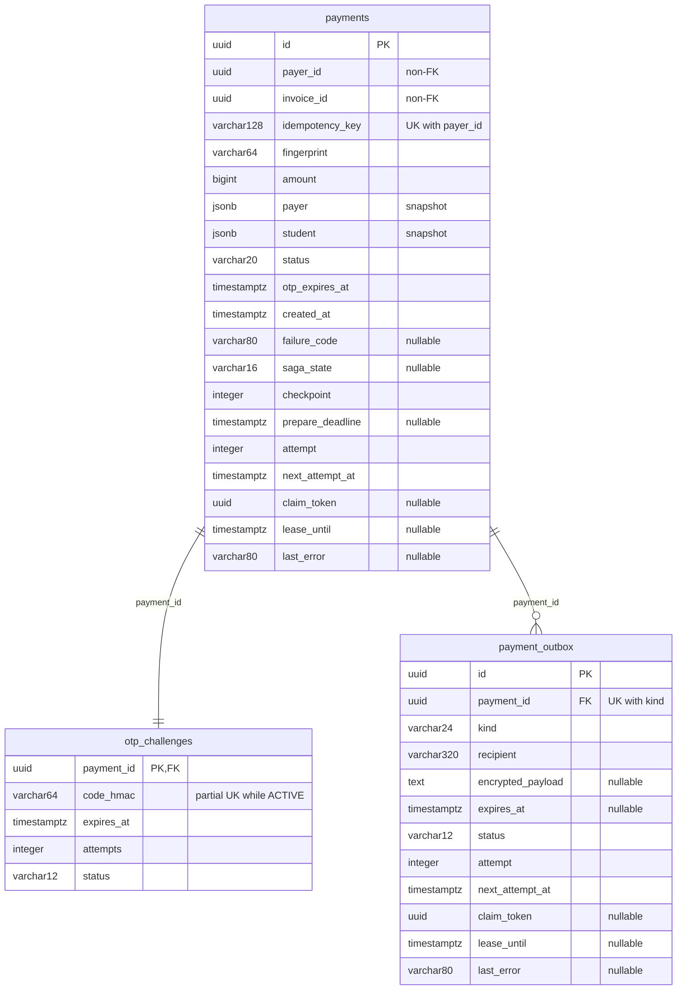
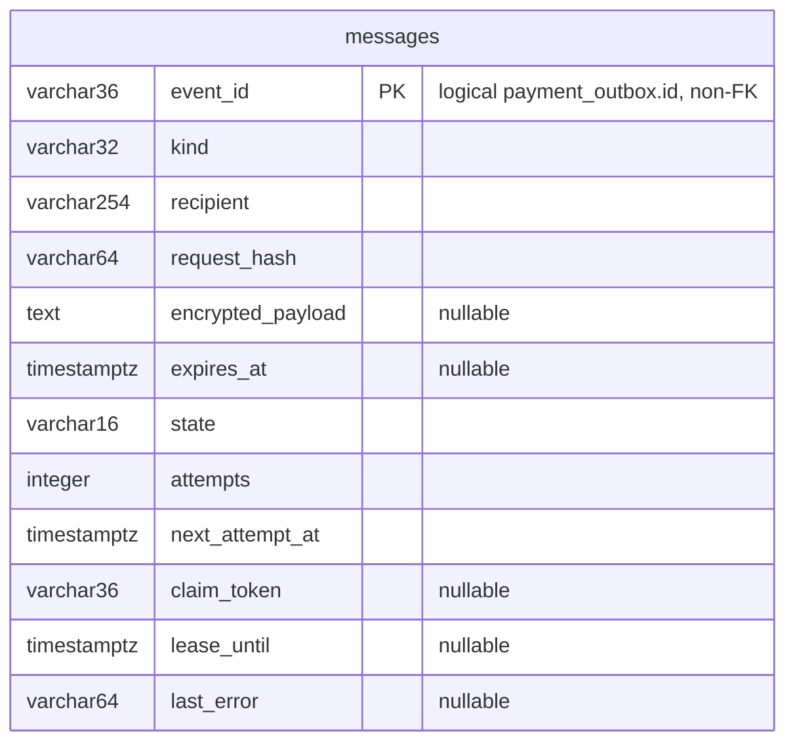

# ERD theo database

Bản SVG: [Auth](rendered/erd-1.svg), [Wallet](rendered/erd-2.svg), [Tuition](rendered/erd-3.svg), [Payment](rendered/erd-4.svg), [Notification](rendered/erd-5.svg).

Các bảng/field dưới đây đối chiếu `services/*/models.py` và migration khởi tạo. `PK` là khóa chính, `FK` chỉ quan hệ trong cùng database, `UK` là unique. UUID xuyên service là tham chiếu logic, **không phải FK xuyên database**. Timestamp có múi giờ; tiền dùng BIGINT VND.

## Auth — database `auth`

## Wallet — database `wallet`

CHECK: `balance >= 0`, `0 <= reserved <= balance`, `amount > 0`; reservation có state RESERVED/CAPTURED/CANCELLED. PK `wallet_debits.payment_id` giới hạn một debit mỗi Payment. `available = balance - reserved` được tính khi trả API, không phải cột lưu riêng.

## Tuition — database `tuition`

Unique `student_id` biểu diễn tối đa một khoản hiện hành/MSSV. Khoản thu UNPAID không có owner; RESERVED có `reserved_payment_id`, chưa có `paid_payment_id`; PAID không còn reservation owner. `paid_payment_id` có thể null ở dữ liệu seed đã trả. CHECK amount dương và các giá trị status/state hợp lệ. Một invoice có nhiều lần thử lịch sử, nhưng khóa hàng invoice quyết định tối đa một người thắng.

## Payment — database `payment`

Unique `(payer_id,idempotency_key)` chống tạo Payment trùng; fingerprint phát hiện cùng key nhưng khác payload. Unique `(payment_id,kind)` ngăn lặp email event cùng loại. Partial unique `code_hmac WHERE status='ACTIVE'` chống mã OTP ACTIVE trùng toàn cục. CHECK `attempts BETWEEN 0 AND 5`, amount dương, status/Saga/kind hợp lệ. Index phục vụ lịch sử và công việc tới hạn; saga checkpoint nằm trong `payments`, không có bảng Saga riêng.

## Notification — database `notification`

PK event_id dedup job; request_hash so khớp retry cả khi payload đã bị xóa. State QUEUED/SENT/EXPIRED được CHECK. SMTP có thể gửi lại sau crash trước cập nhật SENT.

## Tham chiếu logic giữa service

| Nguồn | Đích logic | Cơ chế, không FK |
|---|---|---|
| wallets.user_id, payments.payer_id | users.id | JWT subject; Payment gọi hồ sơ Auth bằng REST. |
| payments.invoice_id | invoices.id | Payment đọc và reserve qua REST Tuition. |
| wallet_reservations.payment_id, tuition_reservations.payment_id | payments.id | Payment điều phối lệnh idempotent bằng ID. |
| invoices.reserved_payment_id / paid_payment_id | payments.id | Owner và kết quả thanh toán do REST cập nhật. |
| messages.event_id | payment_outbox.id | PUT nội bộ dedup bằng event ID. |

Mỗi database còn có bảng kỹ thuật `alembic_version` do Alembic quản lý; không thuộc mô hình nghiệp vụ. [Hợp đồng API](../api/CONTRACT.md) quy định chuyển trạng thái và validation không thể biểu đạt hết bằng ERD.
