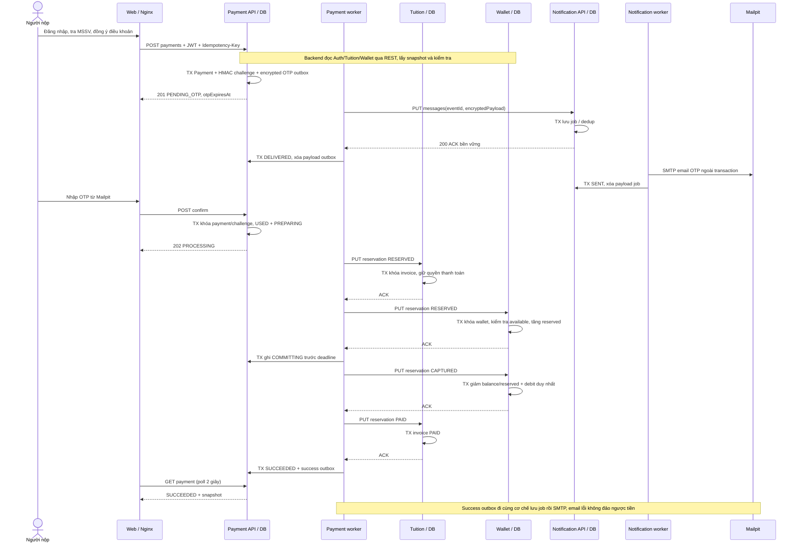
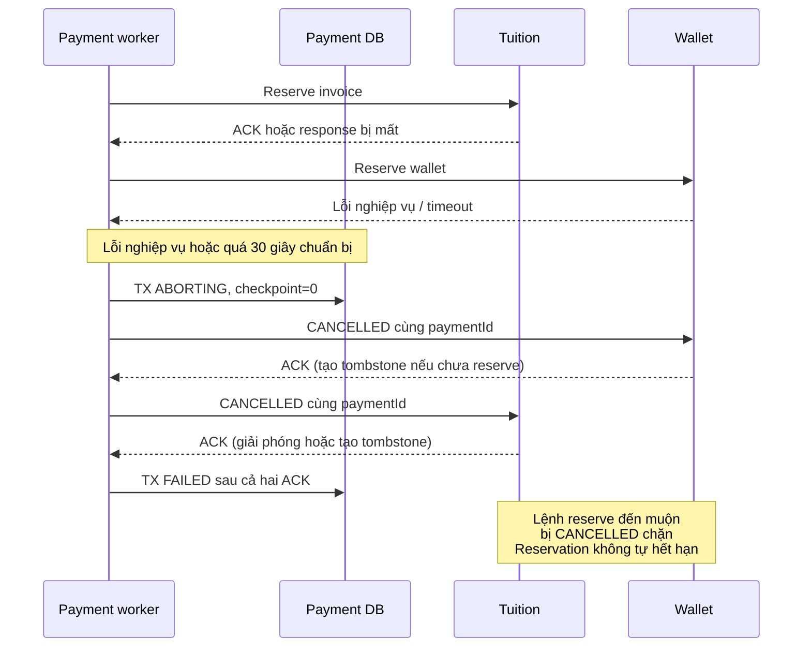
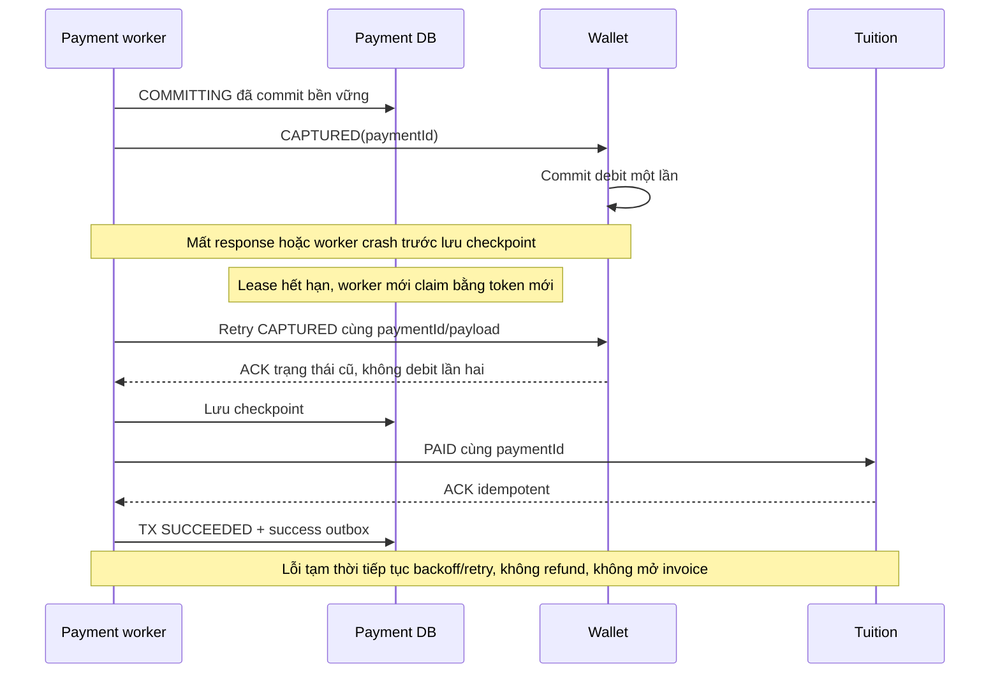

# Sequence: thanh toán, hủy và phục hồi

Bản SVG: [thành công](rendered/sequence-1.svg), [hủy](rendered/sequence-2.svg), [phục hồi](rendered/sequence-3.svg).

## Luồng thành công

Mỗi ACK/checkpoint được ghi bằng transaction cục bộ ngắn. Không có transaction hoặc row lock kéo dài qua HTTP/SMTP. Tạo Payment chưa giữ tiền; số dư được kiểm tra lại khi Saga reserve.

## Hủy trước COMMITTING

Timeout không chứng minh lệnh từ xa thất bại. Khi còn PREPARING và chưa quá deadline, worker có thể retry cùng ID; khi đã quyết định ABORTING thì hủy cả hai bên kể cả chưa biết reserve có thành công hay không.

## Forward recovery từ COMMITTING

Claim dùng khóa `SKIP LOCKED`, lease và token; ghi checkpoint kiểm tra token/lease để worker cũ không thay quyết định mới. Chuyển COMMITTING là điểm quyết định: sự cố kéo dài giữ PROCESSING để phục hồi/đối soát, không biến thành FAILED vì hết lượt retry. Bảo đảm bút toán một lần dựa trên DB/idempotency; không tuyên bố SMTP exactly-once.
