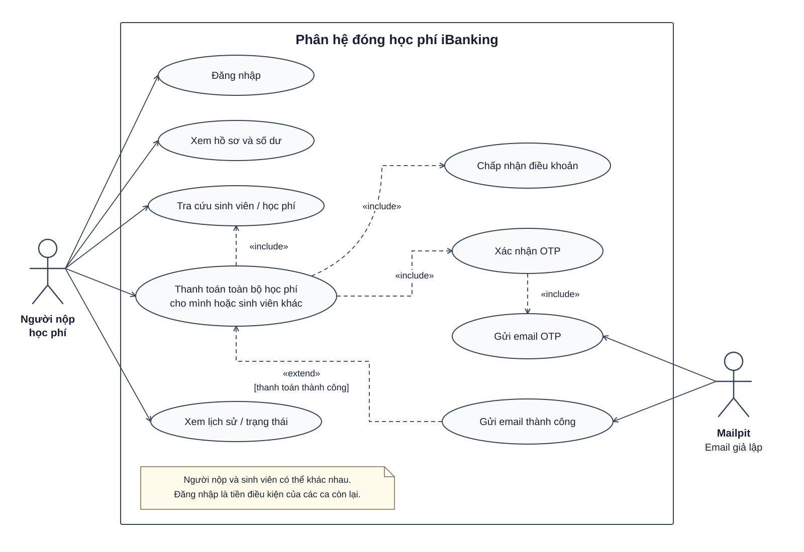
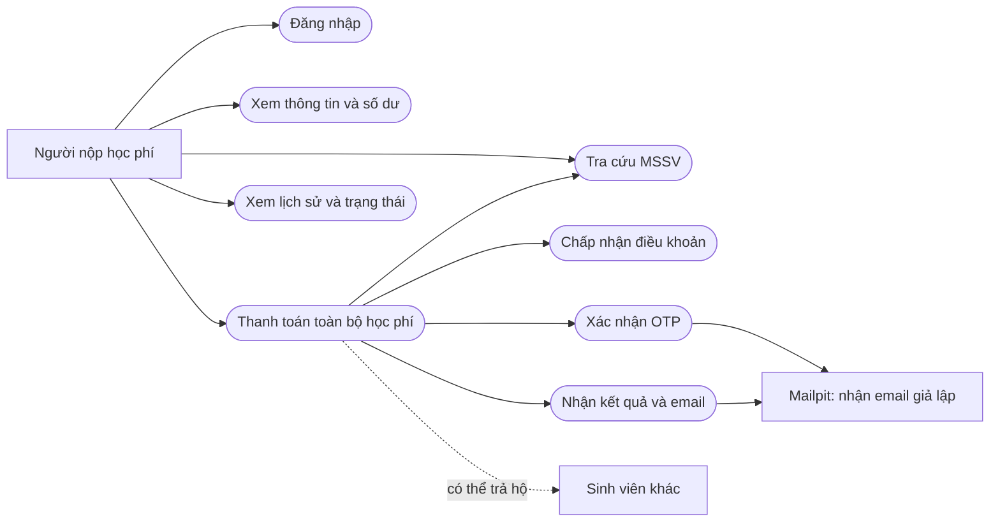

# Ca sử dụng

[Mở bản UML SVG](rendered/use-case-uml.svg). Sơ đồ thể hiện actor, biên hệ thống, các ca sử dụng và quan hệ `include`/`extend` theo [nguồn PlantUML](use-case.puml). Mũi tên `include` trỏ tới ca được bao gồm; mũi tên `extend` trỏ từ ca mở rộng tới ca thanh toán cơ sở.

Bản Mermaid dưới đây và [SVG đọc nhanh](rendered/use_case-1.svg) giúp điều hướng luồng nghiệp vụ, không thay ký pháp UML phía trên.

Người nộp là chủ tài khoản đăng nhập; sinh viên được xác định bằng MSSV và có thể khác người nộp. Sinh viên không cần tài khoản riêng để được trả hộ. Mailpit là hệ thống email giả lập phục vụ trình diễn, không chuyển thư ra Internet.

| Ca sử dụng | Tiền điều kiện / kết quả |
|---|---|
| Đăng nhập | Tài khoản seed và mật khẩu đúng → JWT; sai → báo lỗi. |
| Xem thông tin | JWT hợp lệ → hồ sơ người nộp, số dư khả dụng và lịch sử của chính mình. |
| Tra cứu | MSSV có sinh viên → thông tin sinh viên và khoản hiện hành hoặc không có khoản; không có sinh viên → 404. |
| Thanh toán | Khoản UNPAID, đủ tiền, đồng ý điều khoản → tạo Payment chờ OTP; chưa trừ tiền ở bước này. |
| Xác nhận OTP | OTP đúng, chưa hết hạn/chưa dùng/chưa khóa → xử lý Saga; kết quả chỉ thành công sau ghi nợ và đóng khoản thu. |
| Xem lịch sử | Chỉ chủ Payment được xem; danh sách phân trang, mới nhất trước. |

Nhánh thay thế: thiếu tiền, chưa đồng ý điều khoản, học phí đã trả/đang được giữ, OTP sai/hết hạn/quá lần, dịch vụ tạm mất kết nối. [Sequence](SEQUENCE.md) mô tả xử lý tài chính và phục hồi.
